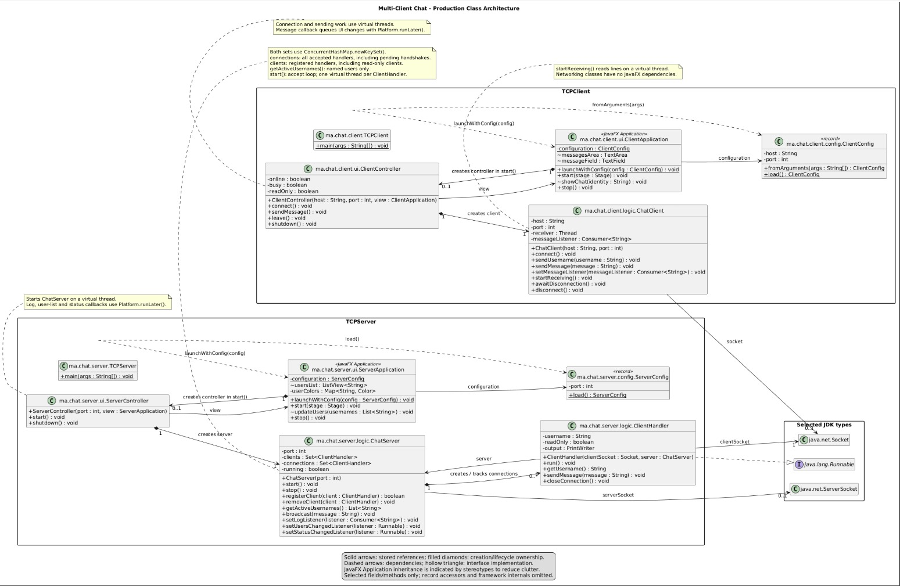
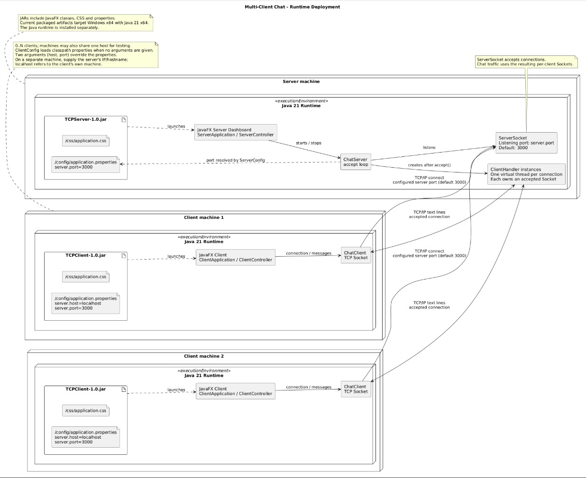
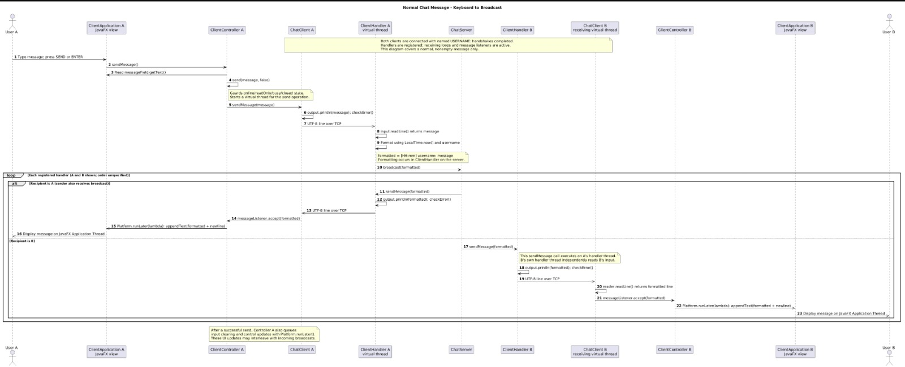

# Multi-Client Chat Application Using Java Sockets

## Overview

A university Java networking mini-project with a central TCP server and multiple JavaFX clients sharing a real-time group chat. Each server connection is handled by a Java virtual thread. TCPServer and TCPClient are independent Maven applications.

## Features

### Client

- Username identity; blank username enables READ-ONLY MODE.
- Send with SEND or ENTER and receive group messages in real time.
- `allUsers` privately lists active named users; `bye` and `end` disconnect.
- LEAVE disconnects named and read-only clients.
- Online/Offline text and a visual status indicator.
- Window close cleans up the connection.

### Server

- Multiple concurrent connections with one virtual thread per client.
- Broadcasts messages as `[HH:mm] username: message`, using server time.
- Live connected named-user ListView with distinct random background colors.
- Server activity logs and Running/Stopped status indicator.
- Continues accepting clients after individual disconnections.
- Clean shutdown closes the listener and all connections, including pending handshakes.

## Technology Stack

- Java 21 and Java virtual threads.
- Maven 3.9+ and JavaFX 21.0.9.
- `java.net.ServerSocket` and `java.net.Socket`.
- UTF-8 line-based communication with `BufferedReader` and `PrintWriter`.
- External CSS and `java.util.Properties`.
- Maven Shade for executable JARs; PlantUML for architecture diagrams.

## Architecture

```text
ClientApplication -> ClientController -> ChatClient
ServerApplication -> ServerController -> ChatServer -> ClientHandler (one per connection)
```

`TCPClient` and `TCPServer` resolve configuration through `ClientConfig` and `ServerConfig` before launching JavaFX. Application classes build views; controllers coordinate actions and callbacks. Networking/business logic in the `logic` packages is independent of JavaFX presentation. Blocking networking work runs off the JavaFX Application Thread; controllers queue UI updates with `Platform.runLater()`.

The server uses thread-safe collections for all accepted connections and registered broadcast recipients. Anonymous handlers receive broadcasts but are excluded from active named-user lists.

The class diagram below shows the structure; the [UML section](#uml--technical-architecture) has the deployment and sequence diagrams.



## Project Structure

```text
Multi-Client-Chat/
|-- TCPServer/
|   |-- pom.xml
|   `-- src/main/
|       |-- java/ma/chat/server/   # entry point, config, logic, ui
|       `-- resources/           # config/application.properties, css/application.css
|-- TCPClient/
|   |-- pom.xml
|   `-- src/main/
|       |-- java/ma/chat/client/   # entry point, config, logic, ui
|       `-- resources/           # config/application.properties, css/application.css
|-- docs/
|   |-- class-diagram.puml / .png
|   |-- deployment-diagram.puml / .png
|   |-- sequence-diagram.puml / .png
|   `-- Project-Report.pdf        # exported project report
|-- tests/
|   `-- LogicSmokeTest.java       # headless test of the networking logic
|-- README.md
`-- .gitignore
```

Each project generates its own ignored `target/` directory. There is no root parent/aggregator POM. Local IDE metadata and development screenshots are ignored.

## Configuration

Server: [TCPServer/src/main/resources/config/application.properties](TCPServer/src/main/resources/config/application.properties)

```properties
server.port=3000
```

Client: [TCPClient/src/main/resources/config/application.properties](TCPClient/src/main/resources/config/application.properties)

```properties
server.host=localhost
server.port=3000
```

Both applications load `/config/application.properties` from the classpath at startup. To change packaged defaults, edit the source resource and rebuild the JAR. Settings are not loaded from an external working-directory file or reloaded while running.

With no client arguments, properties are used. Exactly two arguments, host and port, override client properties. Supplying only one argument is invalid.

## Build From Source

Install JDK 21 and Maven 3.9+, set `JAVA_HOME` to the JDK, and put `java` and `mvn` on PATH. Run from the repository root:

```powershell
mvn -f TCPServer/pom.xml clean package
mvn -f TCPClient/pom.xml clean package
```

The first build needs access to Maven repositories. Maven resolves JavaFX; a separate JavaFX SDK is unnecessary. In IntelliJ IDEA, import both POMs as Maven projects and select JDK 21 for the project and Maven runner.

## Run Executable JARs

The current packaged JARs were tested on **Windows x64 with Java 21 x64**. They include JavaFX dependencies and Windows native libraries, but not a Java runtime. Maven is required for building, not for running the resulting JARs.

From the repository root, start the server:

```powershell
java -jar TCPServer/target/TCPServer-1.0.jar
```

In another terminal, start a client using properties:

```powershell
java -jar TCPClient/target/TCPClient-1.0.jar
```

Or supply the server address and port:

```powershell
java -jar TCPClient/target/TCPClient-1.0.jar localhost 3000
```

Repeat the client command for additional clients. Enter a username and select CONNECT, or leave it blank for read-only access. From another computer, replace `localhost` with the server machine's IP address or hostname and ensure its listening port is reachable. `localhost` refers to the local machine.

JavaFX may print an unnamed-module configuration warning with these shaded JARs; packaged functional testing passed with this warning.

## Chat Commands

Commands are exact and case-sensitive. Enter them in the message field and send.

| Command | Behavior |
| --- | --- |
| `allUsers` | Returns active named users only to the requester. |
| `bye` | Disconnects the current named user. |
| `end` | Disconnects the current named user. |

Other lines are normal group messages. READ-ONLY users cannot send messages or commands. LEAVE or closing the window also disconnects a client.

## Read-Only Mode

Leave the username blank when connecting. The client remains connected and receives group broadcasts, but sending controls are disabled. The server also rejects attempted messages and commands from anonymous connections. Anonymous clients do not appear in `allUsers` responses or the server's named-user ListView.

## UML / Technical Architecture

### Class Diagram (required)

Production classes and relationships of both applications, split into entry point, view, controller and JavaFX-free logic.


### Deployment Diagram (required)

Runtimes, executable JARs, configuration files and the TCP/IP connections between the server machine and the client machines.



### Sequence Diagram (additional)

A normal chat message, from User A's keyboard to the display on every connected client.



The editable PlantUML sources are [class-diagram.puml](docs/class-diagram.puml), [deployment-diagram.puml](docs/deployment-diagram.puml) and [sequence-diagram.puml](docs/sequence-diagram.puml). To regenerate the PNG files with a PlantUML renderer installed, run from the repository root:

```powershell
plantuml -tpng docs/class-diagram.puml docs/deployment-diagram.puml docs/sequence-diagram.puml
```

## Testing

The `logic` packages do not depend on JavaFX, so the networking behaviour can be tested without Maven or a display. `tests/LogicSmokeTest.java` starts a real `ChatServer` and connects `ChatClient` objects over TCP to check broadcasts, read-only mode, `allUsers`, `bye`/`end`/LEAVE, duplicate names and server shutdown (18 checks). From the repository root in PowerShell:

```powershell
$out = Join-Path $env:TEMP "chat-logic-test"
javac -d $out TCPServer/src/main/java/ma/chat/server/logic/ChatServer.java TCPServer/src/main/java/ma/chat/server/logic/ClientHandler.java TCPClient/src/main/java/ma/chat/client/logic/ChatClient.java tests/LogicSmokeTest.java
java -cp $out LogicSmokeTest
```

The expected last line is `ALL TESTS PASSED`. The JavaFX screens are tested manually with the packaged JARs; the 13 manual cases are listed in the project report.

## Project Report

A detailed report (requirements traceability, architecture, protocol, concurrency model, configuration, UI, testing and limitations) accompanies this repository as `docs/Project-Report.pdf` (or `.docx`). It embeds the three diagrams above.

## Executable Artifacts

After building, submit these two executable files:

- `TCPServer/target/TCPServer-1.0.jar`
- `TCPClient/target/TCPClient-1.0.jar`

The `*-1.0-SNAPSHOT.jar` files are intermediate thin JARs, not executable submission artifacts. No separate dependency folder is needed. Generated `target/` contents are ignored by Git; distribute the executable JARs separately with the university submission or as GitHub release assets.

## Demo

1. Start the server.
2. Start multiple named clients.
3. Send messages and observe broadcasts.
4. Run `allUsers` and observe the private response.
5. Connect a blank-username client and demonstrate read-only reception.
6. Disconnect a client.
7. Show the server dashboard, user list, colors and logs.

## Known Limitations

- Duplicate usernames are allowed.
- Configuration is loaded only at startup; changing packaged defaults requires rebuilding.
- Current shaded JARs contain platform-specific libraries and were tested on Windows x64.
- Persistence, encryption and automatic reconnection are outside the assignment scope.
